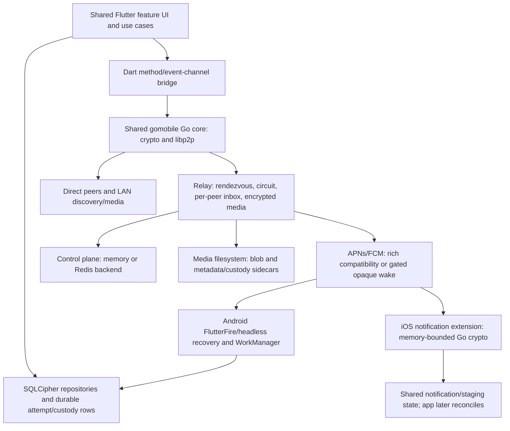
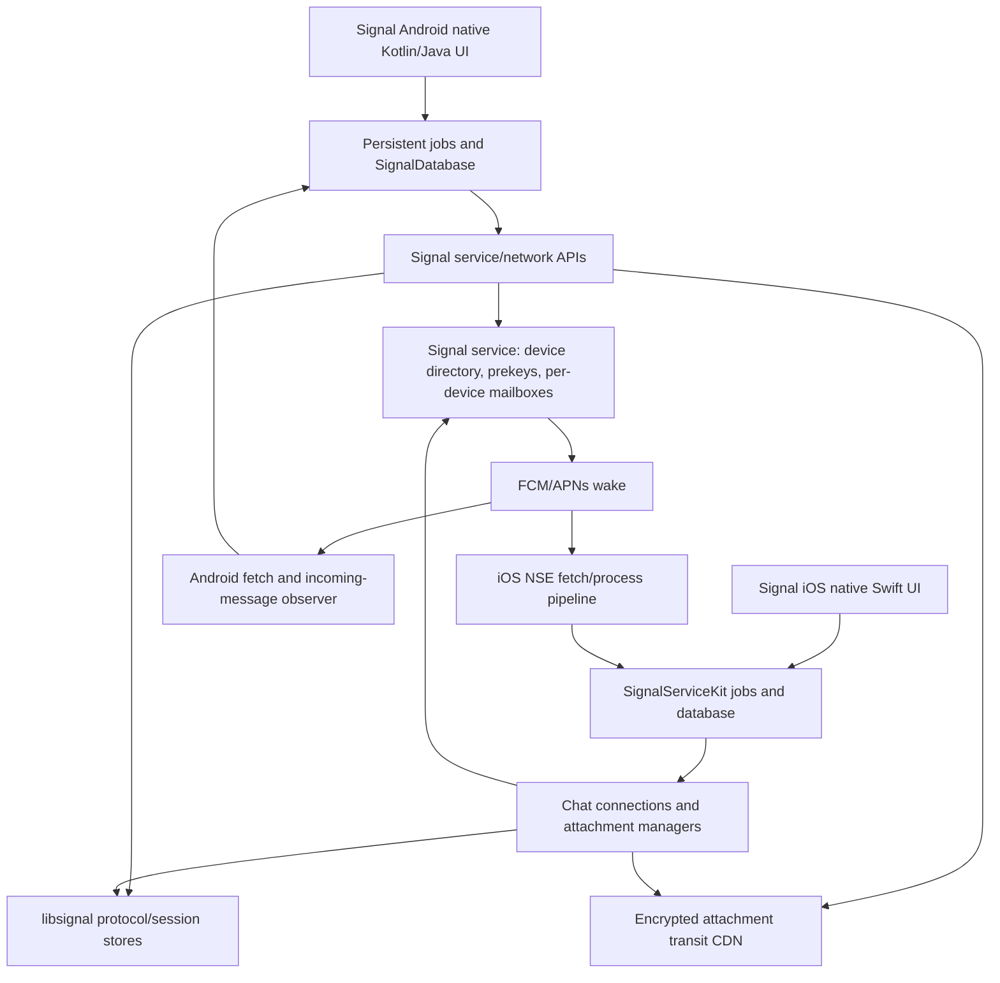

# Mknoon versus Signal: Android and iOS source comparison

Reviewed 11 October 2026. Architecture first, then four end-to-end flows. This is a source review, not a benchmark, penetration test, device campaign, or certification of a shipped binary.

## 1. Baselines and evidence rules

| Codebase | Exact baseline | Important qualification |
|---|---|---|
| Mknoon Android and iOS | Checkout HEAD `b8f7736a81e4fa094c2e743b2cf464dec21032c6`, **plus existing working-tree changes**; `pubspec.yaml` declares `1.0.1+123` | Current files establish behavior. Build-number overrides, installed binaries, signed artifacts, live relay settings and persistence configuration were not inspected. See [dependency/version declaration][M-version] and the adjacent evidence manifest. |
| Signal Android | Tag `v8.30.3`, commit `9a8f9ba79a3218ba2bddab1dabe7d23bae4cbc66`; published 7 October 2026 | Upstream release source, not proof of any particular Play Store install. libsignal **0.103.0** is pinned in the [version catalog][A-version]. |
| Signal iOS | Tag `8.32.0.1910`, commit `4046e74fe7b52f7790337ede04bde76fc173f23f`; published 9 October 2026 | Upstream release source, not proof of an installed App Store artifact. libsignal **0.103.1** is pinned in [Podfile.lock][I-version]. |
| Signal cryptographic implementation | Android libsignal `v0.103.0` / `ba133bd3457f556fbf56db0a5ab985de0af79da6`; iOS `v0.103.1` / `e8cc2dddd578859b4a029c9c94670b24ce2b616a` | Relevant protocol source inspected at both dependency versions. |

Release provenance: [Signal Android release](https://github.com/signalapp/Signal-Android/releases/tag/v8.30.3), [Signal iOS release](https://github.com/signalapp/Signal-iOS/releases/tag/8.32.0.1910). The evidence manifest hashes the cited app files and lists the pre-existing working-tree changes. No app code was changed during this review.

**O = observed** executable source behavior or explicitly attributed documentation. **I = inference** derived consequence, with assumptions stated. **U = unknown** requiring additional evidence. A test's presence is O for coverage intent, not proof that it passed here. A flag default is O for builds omitting overrides, not proof of live rollout settings. Recommendations are proposals, not observations.

**Scope:** ordinary one-to-one text, sender/recipient offline behavior, ordinary attachments with protected/linked differences, and adding a second device. Group transport and membership are mapped to establish the architectural boundary; this is not a complete group-crypto, calls, backups, account-migration, parser, or supply-chain audit. Account migration is not device linking.

## 2. Requirements that constrain the comparison

The [Private and Reliable Notifications PRD v1.2][M-requirements] is a **proposed target state** with dated adopted decisions. It requires durable per-device inbox custody; low-latency direct/pubsub delivery; fixed generic APNs/FCM wakes without sender/conversation/content metadata; local decrypt/deduplication/policy; acknowledgement distinct from notification outcome; and reuse of existing owners instead of creating a queue or scheduler per modality. It explicitly accepts provider-token and timing visibility. Its same-chat foreground behavior is quiet visual update only. These are requirements, not evidence that all code paths satisfy them.

**O:** mnemonic-derived identity and Peer IDs, direct/LAN transport and relay fallback are present in [identity code][M-identity] and [send code][M-send]. **I:** portable identity without phone-number registration and useful LAN/direct operation are design priorities worth preserving. This review did not locate a newer authoritative product decision making either an unconditional requirement, or declaring a numeric battery, latency, offline-retention or attachment-size SLA. Recommendations below therefore preserve them and identify decisions that need explicit product targets.

## 3. Architecture maps

**O, Mknoon:** production bootstrap creates `GoBridgeClient`; the channel command map reaches Go identity, ML-KEM encryption, signing, libp2p and blob operations. Flutter owns domain/persistence/presentation decisions; Go owns network and crypto operations. Both platforms share that core, while lifecycle and notification entry points differ. Local storage uses SQLCipher and secure-key storage. The relay has selectable memory/Redis control-plane backends and filesystem media. Sources: [bootstrap][M-bootstrap], [bridge][M-bridge], [Go dependencies][M-go], [database opener][M-sqlcipher], [relay composition][M-backend], [media store][M-media].

**O:** Go dependencies include libp2p `v0.50.0`, CIRCL `v1.6.3` and three locally replaced transport dependencies; the declared Go version is `1.27.1`. Flutter's pubspec declares Dart `^3.9.0`, Flutter `>=3.47.2`, and local plugin forks. These are declared constraints/pins, not measured installed toolchains. [Go module][M-go], [Flutter dependencies/forks][M-native-forks].

**O, Signal:** Android and iOS are separate native applications, sharing protocol implementation through libsignal rather than a shared Flutter application core. Android separates persistent job orchestration, SQLCipher-backed database, message processing and network APIs. iOS uses SignalServiceKit, database transactions, persistent send jobs and dedicated attachment managers. Ordinary chat traffic goes through the Signal service; encrypted attachment bytes use a separate CDN path. Both establish sessions per recipient device. Sources: [Android database][A-db], [jobs][A-jobs], [message service][A-service], [iOS database][I-db], [send queue][I-jobs], [sender][I-send], [uploads][I-upload].

**O:** Android's new `IndividualSendJobV2`/`MessageService` path is remote-config gated with source default **false**. Its incumbent path uses `IndividualSendJob`/`SignalServiceMessageSender`. Both were considered; live Signal remote configuration is U. [dispatch][A-send], [config][A-config], [new path][A-send-v2], [network orchestration][A-network].

**O, group architecture boundary:** Mknoon also has a Go group/pubsub transport and AES-GCM group-key primitive, with separate group inbox and membership/recovery owners; ordinary direct-message conclusions must not be generalized to that key lifecycle. Signal has dedicated group-send and sender-key machinery on both native stacks. This report maps those components but does not claim equivalent group membership privacy or group forward secrecy. [Mknoon group transport][M-group-transport], [group crypto][M-group-crypto], [Android group send][A-group], [iOS sender-key send][I-group].

**I:** Mknoon's shared core reduces duplicate cross-platform feature implementation but creates additional Dart/native/Go and app/extension ownership boundaries. Signal's service route reduces client route-selection states, while requiring a service/CDN deployment and two native application stacks. Neither architecture implies better measured battery life or fewer bugs.

## 4. Flow one: sending and receiving a text message

### Trace

**Mknoon — O:**

1. `sendChatMessage` qualifies contact/target, creates a logical payload, requires recipient encryption material, and encrypts the inner JSON through Go. The ordinary direct v2 envelope exposes type/version, ID/event ID where applicable, sender Peer ID and encrypted fields; username/body stay inside ciphertext. No end-to-end sender signature field is present in that envelope. [send][M-send], [envelope][M-wire], [crypto][M-encrypt].
2. It atomically stages the attempt and immutable wire envelope before network work. Retries can reuse committed bytes. Initialized linked rosters use independently encrypted targets and an atomic all-target stage when selected. [send][M-send], [fanout][M-fanout], [DB guards][M-db].
3. It tries authenticated live delivery through reusable direct connection or a LAN/direct/relay-live race. Unknown-presence targets start inbox custody immediately; connected/local targets have a **2,500 ms send-entry hedge**. Relay-live has a **500 ms stagger** and an encrypted-payload cap of **96 KiB**. These are policy constants, not measured end-to-end latency. [race/hedge][M-race].
4. Receiver decrypts, binds outer sender to physical transport and inner sender to the logical authorized contact, rejects unauthorized/unknown contacts, deduplicates and persists. It sends delivery receipts after durable receive handling; LAN/direct committed acknowledgements and relay custody are distinct evidence. [receive authorization][M-receive], [incoming commits][M-db].

**Signal Android — O:** persisted outgoing message → `IndividualSendJob` → device session/prekey resolution → libsignal encrypt per device → service submission → local sent state and linked-device transcript. The V2 branch has explicit device-mismatch/stale-session recovery and classified retry errors; the incumbent branch also establishes sessions per device. Receive: FCM or an active connection → incoming observer → decrypt/content handling and buffered protocol-store flush inside a DB transaction → post-commit server ACK. Failed ACK allows redelivery; unparseable envelopes can be intentionally ACKed/discarded. [incumbent sender][A-send], [session construction][A-service], [V2][A-send-v2], [receive transaction][A-receive], [content processor][A-content].

**Signal iOS — O:** persisted `MessageSenderJobRecord` → queue starts after transaction completion → prekeys/session resolution → libsignal encryption → service submit and transcript handling. Receive: chat callback → `MessageProcessor` serial/batched transaction → libsignal decrypt and message processing → completion registered after commit → server ACK closure. Background receive batches are limited to one for progress under suspension pressure. [queue][I-jobs], [sender][I-send], [processor][I-receive], [decrypter][I-decrypt], [ACK callback][I-socket].

### Comparison

| Dimension | Source-backed comparison and limits |
|---|---|
| Reliability | **O:** both retain outgoing work and distinguish network/service acceptance from recipient processing. Mknoon needs dedupe across several delivery legs; Signal needs dedupe/redelivery plus session/device-list recovery. **I:** Mknoon's atomic attempts and presence-independent hedge are valuable protections. Source does not establish real loss rates or a universal exactly-once guarantee. |
| Performance | **O:** Mknoon can avoid a service hop over LAN/direct transport; live races have explicit deadlines/staggers. Each v2 direct encryption carries a 1,088-byte ML-KEM ciphertext, base64 encoded to 1,452 characters, plus nonce/tag/JSON. **I:** warm LAN can be faster; repeated KEM payloads and bridge crossings can cost bandwidth/CPU. **U:** p50/p95/p99, cold discovery cost, battery and Signal comparison require measurement. |
| Security | **O:** Mknoon encapsulates to a reusable recipient ML-KEM key and uses the shared secret directly as an AES-GCM key; no message-key/session ratchet is in the traced path. Signal's pinned libsignal initializes mandatory SPQR state and combines classical/message chains with post-quantum ratchet contributions. **I:** compromise of a retained Mknoon KEM private key enables decryption of recorded envelopes addressed to that key; independent fresh encapsulations do not give forward secrecy against that compromise. [Mknoon decrypt][M-decrypt], [Android ratchet][L-android], [iOS triple ratchet][L-ios]. |
| Privacy | **O:** Mknoon's outer direct envelope exposes stable sender/type/ID to a relay; direct peers necessarily see each other's network endpoints. Signal has sealed-sender paths that reduce sender metadata visible to its service, with fallback to unsealed sending in applicable cases. **I:** P2P avoids some central observations but is not automatically more metadata-private. [envelope][M-wire], [Signal service][A-network], [iOS sender][I-send]. |
| Maintainability | **O:** Mknoon's send file has 5,475 lines, receive file 2,627, bootstrap 10,630 at this baseline. **I:** routing, modality and rollout branches create a costly review surface; LOC is a navigation indicator, not a defect count. Signal has a clearer protocol-library boundary but significant native duplication and a second Android send implementation during migration. |

**Security review required:** public-key encryption authenticates ciphertext integrity, not the sender by itself. Live Mknoon transport identity binding is observed; offline delivery trusts relay-returned sender metadata. Assess a malicious relay's ability to create ciphertext to a known recipient key and claim another sender, and the analogous notification-preview paths. This is a concrete threat-model question, **not a demonstrated exploit**. The normal relay binds submissions to its authenticated remote peer. [envelope][M-wire], [receiver][M-receive], [relay admission][M-relay-auth]. Adding public signatures would affect deniability; authenticated session protocols are a broader option.

Signal protocol context: [PQXDH specification](https://signal.org/docs/specifications/pqxdh/), [ratchet specification](https://signal.org/docs/specifications/doubleratchet/), [SPQR announcement](https://signal.org/blog/spqr/). Library design supports forward secrecy and recovery under protocol assumptions; this review does not certify endpoint security, key erasure or every deployed peer's negotiated state.

## 5. Flow two: offline delivery and background wake-up

### Trace

**Mknoon — O:** a sender offline retains its staged outgoing envelope; the existing retrier responds to node/connectivity recovery and periodic triggers. Defaults include 1-second network-restored debounce, 5-second node debounce and a 5-minute periodic retry, with jitter support. These are trigger policies, not guaranteed retry times while the OS suspends the process. [retry owner][M-retry].

For an offline recipient, the send's inbox leg places encrypted work in the recipient transport Peer ID's mailbox. Redis is available; absent `RELAY_BACKEND`, the server chooses **memory**. Protected ACK-or-expiry custody requires Redis and explicit admission; legacy storage still exists. Legacy queue retention is **7 days**, default capacity **100 pending entries per peer**, configurable via `RELAY_MAX_INBOX_MESSAGES_PER_PEER`. The legacy Redis store evicts oldest at capacity while accepting newer work; protected custody instead refuses full admission. [backend][M-backend], [limits][M-limits], [TTL][M-ttl], [legacy overflow][M-redis], [protected contract][M-custody]. Actual deployed backend/capacity/persistence are U.

The app retrieves pending entries, durably stages raw envelopes, replays them and ACKs stable relay IDs. Protected group entries require their specific replay proof; ordinary direct relay ACK eligibility is based on durable staging and may survive a deferred/failed decrypt. That is transfer of custody to the device, not necessarily visible-message delivery. [inbox coordinator][M-inbox].

**Android — O:** rich-push/headless handling and WorkManager recovery exist; opaque fixed-wake registration is gated on combined admission and a live consumer read-back. **iOS — O:** the supplied NSE build uses `nse_lite`; mailbox retrieval returns `INBOX_UNAVAILABLE`, while rich ciphertext decrypt remains. `isIosNseOpaqueInboxConsumerCompiledIn()` returns false. Thus enabling the common flag alone does not produce a working iOS fixed-wake consumer. [Android recovery][M-android], [headless processing][M-headless], [capabilities][M-wake], [iOS readiness][M-ios-ready], [lite stub][M-nse-lite], [build target][M-nse-build].

**Signal Android — O:** FCM triggers a message fetch; dropped FCM messages trigger normal fetch again. Active websocket handling reconnects with backoff and processes/ACKs after local transactions. **Signal iOS — O:** NSE runs a fetch/process/side-effect pipeline, handles deadline/cancellation and shared-database availability, then shuts down background fetching before suspension. [FCM][A-fcm], [observer][A-receive], [NSE][I-nse].

**Signal service — documented:** each device has an independent queue. Signal's linked-history article describes a **45-day** mailbox/attachment retention window and removal of messages following recipient acknowledgement. This is public service documentation, not a server deployment verified by this client audit. [independent queues](https://support.signal.org/hc/en-us/articles/5532268300186-Disappearing-Messages-with-a-Linked-Device), [retention explanation](https://signal.org/blog/a-synchronized-start-for-linked-devices/). Device inactivity/unlink rules are a separate boundary; do not turn that number into an unconditional delivery SLA.

### Comparison

| Dimension | Source-backed comparison and limits |
|---|---|
| Reliability | **O:** Mknoon's legacy cap/expiry and memory-backend defaults permit loss of undelivered work under those conditions; protected reject-full preserves older obligations. Its durable local staging is a strong crash-recovery boundary. **I:** a queued UI state cannot mean indefinite retention. Signal's documented window is longer, but client review does not prove availability or delivery without recipient reconnection. |
| Performance | **O:** both use wake→fetch/reconcile and reconnect triggers. Mknoon retains multiple recovery lanes/periodic work; Signal Android batches commits, while iOS constrains background batch size. **U:** recovery latency, wake cost, Doze behavior, NSE memory and provider delays need live measurement. |
| Security | **O:** Mknoon verifies authenticated transport at relay submission, but offline replay inherits sender information from the relay and retained KEM secrets; Signal decrypts through per-device session stores. **I:** review replay, malicious relay, old-key retention and key-change behavior separately from crash recovery. |
| Privacy | **O:** rich compatibility pushes include plaintext `type`, `sender_id`, and optional `message_id`, even when body fields are encrypted. Fixed opaque wakes are gated/default-off and iOS readiness is false. This conflicts with the PRD's target platform-payload contract for that path. **U:** actual installed capability registration and provider requests. [push builder][M-push], [gating][M-wake], [iOS readiness][M-ios-ready]. Signal's clients fetch message content after wakes; exact live APNs/FCM payloads were not captured. |
| Maintainability | **I:** keep durable custody, wake dispatch and local presentation as separate responsibilities, using existing owners. Mknoon's compatibility/strict/opaque and foreground/headless/NSE combinations create more configuration states than one steady-state fetch pipeline. Signal still has extension/database coordination and recovery complexity. |

A successful direct receive ACK does not establish that an OS notification appeared. Mknoon's PRD correctly separates delivery ACK from completed local notification outcome. Likewise, the ordinary direct staging ACK should not be described as successful decrypt/render. Preserve both distinctions in telemetry and user-facing status.

## 6. Flow three: attachment transfer

### Trace

**Mknoon — O:** validate/pick/process the source → generate a fresh 32-byte blob key → AES-GCM encrypt to an owned ciphertext artifact → hash it → upload through the Go media protocol or offer the same ciphertext over LAN → send encrypted attachment metadata/key/nonce in the parent message. Group limits include 25 MiB images, 250 MiB video, 16 MiB audio and 100 MiB files; document validation currently permits supported PDF MIME plus `%PDF-` signature. The relay's default maximum blob and pending bytes per recipient are each 5 GiB, not a safe device memory budget. [upload][M-upload], [file crypto][M-filecrypto], [network stream][M-media-stream], [group limits][M-group-size], [document validation][M-document], [relay limits][M-media].

`EncryptFile` and `DecryptFile` read the complete input and allocate complete output. Network upload/download streams bytes, so network streaming does **not** make the full crypto path memory-bounded. AES-GCM tag verification occurs before decrypted-file output. [file crypto][M-filecrypto].

Receiver checks metadata/hash/crypto, uses owned paths, promotes locally and then deletes legacy relay data or ACKs an exact strict-custody commitment. Strict custody has recipient-scoped identity, hash/size/expiry proof and durable markers, but ordinary direct client adoption is default-off. Relay media loads persistent metadata sidecars on restart; older reports of exclusively in-memory metadata are superseded by current source and a restart test. [download][M-download], [strict ACK owner][M-media-ack], [custody store][M-media-custody], [flag][M-media-flag], [sidecar reload][M-media-restore], [restart test][M-media-test].

**Signal Android — O:** compression/upload jobs are dependencies of the message-send job; upload persists resumable specification, key/IV and result. Encrypted attachment pointer travels through the message; recipient download applies size limits, verifies digest and decrypts through streaming APIs. [send dependencies][A-send-v2], [upload][A-upload], [download][A-download], [stream encryption][A-filecrypto].

**Signal iOS — O:** dedicated upload records/task queues and resumable upload recovery; encrypted pointers feed persistent download queues and local decryption. File crypto operates in chunks. [upload manager][I-upload], [resumption][I-resume], [download manager][I-download], [file crypto][I-filecrypto]. Public documentation describes expiry-based transit deletion without tracking attachment-pointer recipients; backup/media-tier behavior is separate and outside this audit. [attachment retention/privacy](https://signal.org/blog/a-synchronized-start-for-linked-devices/).

### Comparison

| Dimension | Source-backed comparison and limits |
|---|---|
| Reliability | **O:** Mknoon has integrity checks, restart-persistent relay metadata, local retries, LAN staging and stronger gated custody. Its inspected media upload request streams a complete blob without a resumable offset/session interface; interruptions can require retransmission. Signal has explicit resumable upload state on both platforms. **U:** interrupted-transfer success rate, atomicity under storage failure and deployed strict adoption. |
| Performance | **I, strong:** whole-file crypto makes Mknoon peak memory grow with attachment size and can dominate low-memory devices even with streaming network I/O. It can reuse one ciphertext across LAN/relay, saving repeat crypto. Signal's chunked crypto/resumable transfer offers bounded working buffers and less re-upload work after interruption; comparative throughput still needs measurement. |
| Security | **O:** random blob key, AEAD verification and content-hash checks are useful. **I:** attachment keys inherit the confidentiality lifetime of their enclosing message encryption; lack of message forward secrecy affects recorded attachment pointers/keys too. A chunked/resumable protocol needs reviewed nonce, ordering, truncation and final-manifest authentication. Source review does not certify secure deletion or plaintext-at-rest protection. |
| Privacy | **O:** Mknoon sidecars omit sender identity but retain recipient/allowed peers, size and MIME; direct upload uses opaque transport MIME in the inspected path. Relay logs still include partial peer IDs/blob IDs and upload/download activity. Strict per-target ACK aids cleanup but exposes receipt timing to that relay. **I:** Signal's documented expiry-based object handling has a different metadata/storage tradeoff; neither hides IP/timing/size from all observers. [sidecar/logging][M-media], [upload MIME][M-upload]. |
| Maintainability | **I:** typed upload failures and explicit custody/lifecycle owners help, but legacy/strict/private/group/linked branch combinations are costly. Signal's separated transfer managers make ownership clearer, while adding CDN/session/persistent-job complexity. Reuse Mknoon's current transfer owner instead of adding a modality-specific uploader. |

## 7. Flow four: linking a second device

### Trace

**Mknoon — O:** the explicit linked-secondary setup accepts the account mnemonic, writes an expected-role marker, creates/resumes one preparing transport credential, restores the logical account plus **fresh installation-local ML-KEM keys**, then activates that exact credential. Startup fails closed at incomplete states. A dedicated QR binds logical account identity, transport identity and encryption material with account and transport signatures; contacts explicitly trust/revoke bindings. [setup ordering][M-link], [restore/keygen][M-restore], [dual-signed QR][M-qr], [trust/revocation][M-trust].

Direct contact rosters/fanout distinguish logical account from physical mailbox. Blob-free events use per-target encryption and atomic sibling staging; media has its own selector. The three direct linked selectors and group multi-device convergence are **default-off**. The checked release-defines file omits them. Group membership/metadata/history sharing is explicitly conditional, while mute/unread/drafts/notifications are device-local. This is a implemented foundation with limited/default-off adoption, not evidence of complete Signal-equivalent account sync. [fanout][M-fanout], [addressing flag][M-link-flag], [event flag][M-event-flag], [media flag][M-linked-media-flag], [group scope][M-group-link], [release defines][M-release]. External build overrides remain U.

**Signal Android — O:** secondary exposes an ephemeral provisioning identifier/public key; primary scans, obtains a provisioning verification code, encrypts account material to that key, and service registers a distinct device. Repository supports listing/removal and optional encrypted archive transfer, with resumable upload recovery. **Signal iOS — O:** provisioning cipher authenticates the encrypted exchange; coordinator creates device prekeys/registration IDs and performs optional link-and-sync. Account identity private keys are included in provisioning: Signal linking does **not** keep all account secrets exclusively on the primary. [Android link][A-link], [provisioning crypto][A-provision], [iOS coordinator][I-link], [cipher][I-provision], [provisioned material][I-link-message].

Current Signal documentation includes linked Android phones/tablets and expanding linked iPhone support; the old blanket claim that only Desktop/iPad can link is outdated for these baselines. [Signal's August 2026 announcement](https://signal.org/blog/linked-devices-and-android-tablets/). The announcement is feature documentation; this review did not exercise onboarding on these devices.

### Comparison

| Dimension | Source-backed comparison and limits |
|---|---|
| Reliability | **O:** Mknoon's marker-first/activate-last and immutable per-target replay prevent specific crash/shared-mailbox failures. Signal explicitly provisions independent devices and handles device-list changes in send paths. **I:** adding a distinct identity/mailbox is only one part of linking; Mknoon still needs validated history, own-device sent-state convergence, revocation propagation and group continuity before promising a seamless second phone. Those were not end-to-end proven here. |
| Performance | **O:** Mknoon encrypts/fans out per target; Signal also encrypts per device and has separate sync/history work. **I:** fanout work grows with authorized device count; history sync needs batching and concurrency controls. **U:** linking time, history import throughput, wake amplification and per-device CPU/network costs. |
| Security | **O:** Mknoon secondary receives mnemonic-derived account authority plus a separate transport identity. Signal also shares account identity material, but uses authenticated provisioning instead of manual mnemonic entry. **I:** a compromised Mknoon linked device holding the root mnemonic/account key can potentially authorize replacement credentials; revoking its existing transport binding alone cannot revoke knowledge of that root. Exact roster/protocol limits need security review. [setup][M-link], [QR signing][M-qr], [identity derivation][M-identity]. |
| Privacy | **O:** distinct mailboxes stop devices competing for one queue. Signed rosters and per-device trust expose stable account-device relationships to parties receiving them; relay custody sees per-target traffic. **I:** independent transport identities improve addressing isolation, not automatic unlinkability. Signal's service also knows registered device relationships; provisioning/history confidentiality does not erase that metadata. |
| Maintainability | **I:** separate addressing/event/media/group flags are safe rollback boundaries but create support/configuration complexity. Keep receive/retry of committed rows flag-independent. Adopt one documented release capability matrix and separate account restoration/migration from linking. Signal's mature linking still involves substantial provisioning, archive and transcript machinery. |

## 8. Prioritized improvements

Priority combines **user harm**, **evidence confidence**, **exposure under the relevant configuration**, and **effort**. P0 means begin assessment now; it does not assert an exploitable vulnerability. Effort is qualitative: S = one bounded owner/configuration change; M = several owners/platform checks; L = protocol migration or substantial native/device work. No calendar estimates are justified here.

| Rank | Finding / user impact / evidence | Concrete improvement | Effort and tradeoff |
|---|---|---|---|
| **1 · P0 review** | **Strong O/I:** reusable direct KEM secret lacks ratcheting; captured historical envelopes remain decryptable after that key is compromised. Malicious-relay sender authentication also needs review. Affects text and attachment keys. [crypto][M-encrypt], [decrypt][M-decrypt], [wire][M-wire], [auth][M-receive] | Commission a scoped protocol review covering retained secrets, relay impersonation, replay and notification previews. Design a versioned authenticated session protocol with forward secrecy and compromise recovery; evaluate libsignal rather than inventing a new ratchet. First create explicit threat model and migration/interop/key-change acceptance criteria. | **L** implementation, **M** initial review. Adds session state, prekey distribution/rotation, skipped-key limits, restore complexity and licensing/API integration work. P2P can remain the carrier; copying Signal's central registration model is not required. |
| **2 · P1** | **Confirmed policy:** legacy queues evict accepted pending entries at capacity; default cap 100 and 7-day expiry. Can lose an offline user's messages under overflow. Protected reject-full path already exists. [store][M-redis], [limits][M-limits], [protected][M-custody] | Prefer existing ACK-or-expiry custody for eligible/upgraded cohorts; preserve pending sender obligations on `rejected_full`, expose retry/expiry distinctly, alert on cap/expiry metrics. Define a product offline horizon and capacity in bytes/entries before changing it. | **M**. More storage and backpressure; old clients hard-fail non-OK responses, so do not silently change legacy semantics globally. Increasing cap alone postpones loss and raises abuse/cost exposure. |
| **3 · P1** | **Confirmed target mismatch:** rich pushes reveal routing metadata; iOS fixed mailbox consumer is explicitly unavailable. Users cannot currently receive the PRD's full fixed-wake privacy behavior through that default path. [builder][M-push], [iOS][M-ios-ready], [build][M-nse-build] | Add a minimal bounded authenticated mailbox-fetch transport for the NSE, reusing existing custody/ledger/credential contracts. Establish memory/deadline and payload captures, then enable paired opaque/outcome capabilities only for ready cohorts. Keep Android consumer-readiness gates. | **L** iOS adapter/proof; **M** rollout. Extra fetch latency and dependency on network within NSE budget; rich previews are faster when fetch cannot complete. Preserve generic fallback and fail-closed registration until ready. |
| **4 · P1** | **Confirmed default, live exposure U:** missing `RELAY_BACKEND` chooses memory. Redis process persistence/disk/failover settings were not inspected. Users may trust custody that does not survive a restart. [bootstrap][M-backend] | Introduce a production-profile startup requirement for Redis and an explicit development-memory opt-in; retain existing durability gauge. Verify Redis AOF/RDB policy, failure recovery and storage volume before calling it crash-durable. | **S/M**. Production may refuse startup under misconfiguration, trading apparent availability for honest durability. Redis selection alone is not proof of fsync/replication guarantees. |
| **5 · P1** | **Strong O/I:** full-file encrypt/decrypt allocations scale with blob size, although network is streamed. Large media can cause memory pressure/termination. [file crypto][M-filecrypto], [relay ceiling][M-media] | Immediately enforce a device-safe pre-crypto direct-media size/concurrency budget, then implement reviewed versioned chunked authenticated file crypto and resumable transfer in the existing owner. Reuse stable ciphertext for retries. | **S/M** cap/concurrency, **L** new crypto wire format. Lower caps constrain user documents/videos; chunking adds manifest/nonce/resume integrity and compatibility burdens. Do not simply stream unauthenticated plaintext to the viewer. |
| **6 · P1 before linking rollout** | **Strong O/I:** linking exposes root authority and defaults remain off; roster revocation does not erase shared root secrets. Complete history/sent-state parity is unproven. [setup][M-link], [trust][M-trust], [group scope][M-group-link] | Specify primary-authorized one-time provisioning and root/delegated authority boundaries. Decide whether root mnemonic on a secondary is acceptable; if stronger revocation is required, separate device delegation from account-recovery authority. Validate revocation, offline device rejoin and fanout/history convergence before enabling flags. | **L** for narrower authority, **M** bounded rollout proof. Stronger revocation complicates recovery and primary loss; Signal also shares identity secrets, so its UX is a reference, not proof that copying it solves root authority. |
| **7 · P2** | **O/I:** direct/LAN racing may improve latency but may amplify dialing, KEM CPU, duplicate transfer and energy use. No measured comparison. [race][M-race], [retry][M-retry] | Instrument current timings/route wins and measure before altering the 500 ms relay stagger, 2.5 s hedge, concurrency or recovery cadence. Optimize the largest measured bottleneck while preserving custody and committed ACK reserves. | **M**. Faster relay starts may improve tails but increase relay cost; aggressive LAN discovery/dialing may increase battery use and IP exposure. |
| **8 · P2** | **O/I:** stable peer/blob identifiers remain visible in protocol/logging; strict ACKs expose receipt timing. The PRD already limits diagnostic identifiers. [media logs][M-media], [envelope][M-wire], [PRD][M-requirements] | Audit diagnostic exports and retention, redact/hash stable IDs with short-lived correlation, and document the relay/provider/direct-peer metadata threat model. Consider expiry-only or coarser ACK cleanup only if its storage/privacy benefit is quantified. | **S/M** diagnostics; **L** transport anonymity work. Less identifying telemetry makes field diagnosis harder; delayed cleanup consumes more storage. P2P anonymity needs a separate design, not a claim based on encryption alone. |
| **9 · P2** | **O/I:** large orchestration files and rollout permutations increase change/review effort; existing narrow custody and retry owners are strengths. [send][M-send], [bootstrap][M-bootstrap], [fanout][M-fanout] | Extract route-attempt execution and modality adapters behind existing typed contracts as each measured fix needs them; publish a source/build/relay capability matrix. Retire a compatibility path only after usage and rollback evidence. | **M** incremental. Avoid a broad rewrite or new generic scheduler/ledger; those conflict with the PRD's implementation-economy constraint and can disturb already-proven ownership. |

Existing tests support the *specificity* of findings: the [R4 hedge suite][M-hedge-test], [legacy Redis overflow test][M-cap-test], [protected reject-full test][M-strict-test] and [media restart test][M-media-test]. They were inspected, **not executed**. Historical evidence in project documents was not treated as a fresh pass on this dirty candidate.

## 9. Measurements and security work needed to settle the unknowns

| Question | Required evidence; preserve these boundaries |
|---|---|
| Is Mknoon faster or more energy efficient? | Same discovered devices/network/attachment sizes; warm/cold text p50/p95/p99 from tap to durable sender stage, recipient commit, delivery receipt and notification separately. Measure route wins, concurrent dial count, KEM/bridge CPU, radio/energy and bytes. Repeat foreground, background, network switch and reconnect conditions. Signal service distance/load is a confounder. |
| Does offline recovery lose or duplicate messages? | Fault injection at outgoing DB commit, relay STORE reply, Redis persistence/restart, local stage, decrypt/apply and ACK; retry with same immutable IDs. Overflow/expiry tests, delayed receipts, process death and storage-full cases. Distinguish one local message/unread transition from visual notification duplication. |
| Is attachment transfer practical? | Peak app/NSE memory and temp-disk use by size/concurrency; interrupt uploads/downloads mid-stream; restart sender/receiver/relay; measure bytes retransmitted and progress recovery. Corrupt hash/tag/metadata and verify no plaintext promotion before authentication. |
| Is linking ready? | Pinned feature flags on both peers, Android/iOS role correctness, independent mailbox drain, revoke/reenroll, offline catch-up, target-key change, all-target partial failures and restart recovery. Separately prove own-device sent/read/history semantics and group keys/membership; do not infer them from direct fanout tests. |
| Are security/privacy claims supportable? | Independent review of custom KEM composition, lack of AAD/domain separation, sender identity across relay/push, replay/downgrade limits, key replacement/retention, root delegation/revocation and temp/plaintext file lifecycle. Capture redacted *actual* APNs/FCM requests and verify registration capabilities; audit relay/provider metadata and diagnostic retention. Runtime captures cannot prove cryptographic security. |
| What is actually deployed? | Exact signed artifact/source/build defines; relay revision/environment; Redis persistence/failover/volumes; registered consumer capabilities. Signal client remote-config state and deployed service configuration are also unknown. Public source does not bind deployed service behavior. |

Device work must use the project's availability-bounded matrix: discover via `flutter devices --machine`, `adb devices`, and available simulators as applicable; pin every target. Default non-iOS-specific two-peer work to a connected Android plus available Android emulator. Use Appium MCP for UI/permissions/lifecycle and existing campaigns for documented native/protocol assertions. iOS-specific NSE/APNs/locked-device boundaries require an actually available Apple target. Unavailable versions are **N/A by project policy**, not a closure blocker. No device inventory or campaign was run in this source-only review.

No performance winner, measured loss rate, shipped feature-parity claim, or security certification follows from this report. The practical direction is to retain Mknoon's direct/LAN transport and portable identity, strengthen the existing custody/wake boundaries, review session security, and enable linked/opaque/strict features only with exact configuration and platform evidence.

[M-version]: /Volumes/CrucialX9/flutter_app/pubspec.yaml:21

[M-go]: /Volumes/CrucialX9/flutter_app/go-mknoon/go.mod:1

[M-bootstrap]: /Volumes/CrucialX9/flutter_app/lib/app/bootstrap/production_application_bootstrap.dart:5328

[M-bridge]: /Volumes/CrucialX9/flutter_app/lib/core/bridge/go_bridge_client.dart:92

[M-identity]: /Volumes/CrucialX9/flutter_app/go-mknoon/identity/identity.go:1

[M-encrypt]: /Volumes/CrucialX9/flutter_app/go-mknoon/crypto/encrypt.go:17

[M-decrypt]: /Volumes/CrucialX9/flutter_app/go-mknoon/crypto/decrypt.go:14

[M-ring]: /Volumes/CrucialX9/flutter_app/lib/core/secure_storage/ml_kem_secret_ring.dart:6

[M-send]: /Volumes/CrucialX9/flutter_app/lib/features/conversation/application/send_chat_message_use_case.dart:733

[M-race]: /Volumes/CrucialX9/flutter_app/lib/features/conversation/application/send_chat_message_use_case.dart:2690

[M-wire]: /Volumes/CrucialX9/flutter_app/lib/features/conversation/domain/models/message_payload.dart:163

[M-receive]: /Volumes/CrucialX9/flutter_app/lib/features/conversation/application/handle_incoming_chat_message_use_case.dart:580

[M-db]: /Volumes/CrucialX9/flutter_app/lib/core/database/helpers/messages_db_helpers.dart:563

[M-inbox]: /Volumes/CrucialX9/flutter_app/lib/core/services/p2p_impl/p2p_inbox_coordinator.dart:1690

[M-retry]: /Volumes/CrucialX9/flutter_app/lib/core/services/pending_message_retrier.dart:18

[M-backend]: /Volumes/CrucialX9/flutter_app/go-relay-server/server_bootstrap.go:65

[M-redis]: /Volumes/CrucialX9/flutter_app/go-relay-server/backend_redis.go:348

[M-limits]: /Volumes/CrucialX9/flutter_app/go-relay-server/limits.go:14

[M-ttl]: /Volumes/CrucialX9/flutter_app/go-relay-server/inbox.go:29

[M-custody]: /Volumes/CrucialX9/flutter_app/go-relay-server/ack_custody.go:17

[M-relay-auth]: /Volumes/CrucialX9/flutter_app/go-relay-server/inbox.go:4488

[M-push]: /Volumes/CrucialX9/flutter_app/go-relay-server/inbox.go:1337

[M-wake]: /Volumes/CrucialX9/flutter_app/lib/core/bridge/p2p_bridge_client.dart:1260

[M-ios-ready]: /Volumes/CrucialX9/flutter_app/lib/core/notifications/ios_nse_inbox_projection.dart:229

[M-nse-lite]: /Volumes/CrucialX9/flutter_app/go-mknoon/nsebridge/nse_inbox_lite.go:1

[M-nse-build]: /Volumes/CrucialX9/flutter_app/go-mknoon/Makefile:50

[M-nse]: /Volumes/CrucialX9/flutter_app/ios/NotificationService/NotificationService.swift:29

[M-nse-wake]: /Volumes/CrucialX9/flutter_app/ios/NotificationService/NseMailboxWakeCoordinator.swift:137

[M-android]: /Volumes/CrucialX9/flutter_app/android/app/src/main/kotlin/com/mknoon/app/DroppedPushRecoveryWorkScheduler.kt:66

[M-headless]: /Volumes/CrucialX9/flutter_app/lib/features/push/application/background_message_handler.dart:1

[M-filecrypto]: /Volumes/CrucialX9/flutter_app/go-mknoon/crypto/file_crypto.go:40

[M-upload]: /Volumes/CrucialX9/flutter_app/lib/features/conversation/application/upload_media_use_case.dart:149

[M-download]: /Volumes/CrucialX9/flutter_app/lib/features/conversation/application/download_media_use_case.dart:367

[M-media]: /Volumes/CrucialX9/flutter_app/go-relay-server/media.go:19

[M-media-restore]: /Volumes/CrucialX9/flutter_app/go-relay-server/media.go:439

[M-media-custody]: /Volumes/CrucialX9/flutter_app/go-relay-server/media_custody.go:22

[M-media-stream]: /Volumes/CrucialX9/flutter_app/go-mknoon/node/media.go:422

[M-media-ack]: /Volumes/CrucialX9/flutter_app/lib/features/conversation/application/strict_direct_media_blob_download_ack_owner.dart:1

[M-media-flag]: /Volumes/CrucialX9/flutter_app/lib/core/config/direct_media_blob_custody_client_flag.dart:1

[M-group-size]: /Volumes/CrucialX9/flutter_app/lib/core/media/group_media_size_policy.dart:11

[M-document]: /Volumes/CrucialX9/flutter_app/lib/core/media/document_file_check.dart:5

[M-link]: /Volumes/CrucialX9/flutter_app/lib/features/identity/application/linked_secondary_setup_use_case.dart:25

[M-restore]: /Volumes/CrucialX9/flutter_app/lib/features/identity/application/restore_identity_use_case.dart:75

[M-qr]: /Volumes/CrucialX9/flutter_app/lib/features/qr_code/application/direct_linked_device_qr.dart:209

[M-trust]: /Volumes/CrucialX9/flutter_app/lib/features/contacts/application/direct_contact_device_trust.dart:19

[M-fanout]: /Volumes/CrucialX9/flutter_app/lib/features/conversation/application/direct_event_fanout_coordinator.dart:38

[M-link-flag]: /Volumes/CrucialX9/flutter_app/lib/core/config/direct_linked_devices_flag.dart:1

[M-event-flag]: /Volumes/CrucialX9/flutter_app/lib/core/config/direct_linked_event_fanout_flag.dart:1

[M-linked-media-flag]: /Volumes/CrucialX9/flutter_app/lib/core/config/direct_linked_media_fanout_flag.dart:1

[M-group-link]: /Volumes/CrucialX9/flutter_app/lib/features/groups/domain/models/group_multi_device_policy.dart:15

[M-release]: /Volumes/CrucialX9/flutter_app/tool/build/voice_call_release_defines.json:1

[M-sqlcipher]: /Volumes/CrucialX9/flutter_app/lib/core/database/encrypted_db_opener.dart:186

[M-native-forks]: /Volumes/CrucialX9/flutter_app/pubspec.yaml:96

[M-hedge-test]: /Volumes/CrucialX9/flutter_app/test/features/conversation/application/send_chat_message_use_case_test.dart:11445

[M-cap-test]: /Volumes/CrucialX9/flutter_app/go-relay-server/backend_redis_test.go:449

[M-strict-test]: /Volumes/CrucialX9/flutter_app/go-relay-server/ack_custody_backend_test.go:193

[M-media-test]: /Volumes/CrucialX9/flutter_app/go-relay-server/media_test.go:158

[M-requirements]: /Volumes/CrucialX9/flutter_app/UI-23-notification/Mknoon_Private_Reliable_Notifications_PRD_v1.2.md:1

[M-testing]: /Volumes/CrucialX9/flutter_app/docs/testing/TESTING.md:7

[A-send]: https://github.com/signalapp/Signal-Android/blob/9a8f9ba79a3218ba2bddab1dabe7d23bae4cbc66/app/src/main/java/org/thoughtcrime/securesms/jobs/IndividualSendJob.kt#L68

[A-send-v2]: https://github.com/signalapp/Signal-Android/blob/9a8f9ba79a3218ba2bddab1dabe7d23bae4cbc66/app/src/main/java/org/thoughtcrime/securesms/jobs/IndividualSendJobV2.kt#L67

[A-config]: https://github.com/signalapp/Signal-Android/blob/9a8f9ba79a3218ba2bddab1dabe7d23bae4cbc66/app/src/main/java/org/thoughtcrime/securesms/util/RemoteConfig.kt#L1260

[A-service]: https://github.com/signalapp/Signal-Android/blob/9a8f9ba79a3218ba2bddab1dabe7d23bae4cbc66/lib/libsignal-service/src/main/java/org/whispersystems/signalservice/api/SignalServiceMessageSender.java#L2919

[A-network]: https://github.com/signalapp/Signal-Android/blob/9a8f9ba79a3218ba2bddab1dabe7d23bae4cbc66/lib/network/src/main/java/org/signal/network/service/MessageService.kt#L60

[A-receive]: https://github.com/signalapp/Signal-Android/blob/9a8f9ba79a3218ba2bddab1dabe7d23bae4cbc66/app/src/main/java/org/thoughtcrime/securesms/messages/IncomingMessageObserver.kt#L628

[A-content]: https://github.com/signalapp/Signal-Android/blob/9a8f9ba79a3218ba2bddab1dabe7d23bae4cbc66/app/src/main/java/org/thoughtcrime/securesms/messages/MessageContentProcessor.kt#L1

[A-fcm]: https://github.com/signalapp/Signal-Android/blob/9a8f9ba79a3218ba2bddab1dabe7d23bae4cbc66/app/src/main/java/org/thoughtcrime/securesms/gcm/FcmReceiveService.java#L27

[A-db]: https://github.com/signalapp/Signal-Android/blob/9a8f9ba79a3218ba2bddab1dabe7d23bae4cbc66/app/src/main/java/org/thoughtcrime/securesms/database/SignalDatabase.kt#L1

[A-jobs]: https://github.com/signalapp/Signal-Android/blob/9a8f9ba79a3218ba2bddab1dabe7d23bae4cbc66/app/src/main/java/org/thoughtcrime/securesms/jobmanager/JobManager.java#L1

[A-upload]: https://github.com/signalapp/Signal-Android/blob/9a8f9ba79a3218ba2bddab1dabe7d23bae4cbc66/app/src/main/java/org/thoughtcrime/securesms/jobs/AttachmentUploadJob.kt#L140

[A-download]: https://github.com/signalapp/Signal-Android/blob/9a8f9ba79a3218ba2bddab1dabe7d23bae4cbc66/app/src/main/java/org/thoughtcrime/securesms/jobs/AttachmentDownloadJob.kt#L317

[A-filecrypto]: https://github.com/signalapp/Signal-Android/blob/9a8f9ba79a3218ba2bddab1dabe7d23bae4cbc66/lib/libsignal-service/src/main/java/org/whispersystems/signalservice/api/crypto/AttachmentCipherOutputStream.kt#L28

[A-link]: https://github.com/signalapp/Signal-Android/blob/9a8f9ba79a3218ba2bddab1dabe7d23bae4cbc66/app/src/main/java/org/thoughtcrime/securesms/linkdevice/LinkDeviceRepository.kt#L205

[A-provision]: https://github.com/signalapp/Signal-Android/blob/9a8f9ba79a3218ba2bddab1dabe7d23bae4cbc66/lib/libsignal-service/src/main/java/org/whispersystems/signalservice/internal/crypto/PrimaryProvisioningCipher.java#L1

[A-version]: https://github.com/signalapp/Signal-Android/blob/9a8f9ba79a3218ba2bddab1dabe7d23bae4cbc66/gradle/libs.versions.toml#L31

[I-send]: https://github.com/signalapp/Signal-iOS/blob/4046e74fe7b52f7790337ede04bde76fc173f23f/SignalServiceKit/Messages/MessageSender.swift#L69

[I-jobs]: https://github.com/signalapp/Signal-iOS/blob/4046e74fe7b52f7790337ede04bde76fc173f23f/SignalServiceKit/Jobs/MessageSenderJobQueue.swift#L15

[I-receive]: https://github.com/signalapp/Signal-iOS/blob/4046e74fe7b52f7790337ede04bde76fc173f23f/SignalServiceKit/Messages/MessageProcessor.swift#L195

[I-decrypt]: https://github.com/signalapp/Signal-iOS/blob/4046e74fe7b52f7790337ede04bde76fc173f23f/SignalServiceKit/Messages/OWSMessageDecrypter.swift#L405

[I-socket]: https://github.com/signalapp/Signal-iOS/blob/4046e74fe7b52f7790337ede04bde76fc173f23f/SignalServiceKit/Network/OWSChatConnection.swift#L1227

[I-nse]: https://github.com/signalapp/Signal-iOS/blob/4046e74fe7b52f7790337ede04bde76fc173f23f/SignalNSE/NotificationService.swift#L209

[I-db]: https://github.com/signalapp/Signal-iOS/blob/4046e74fe7b52f7790337ede04bde76fc173f23f/SignalServiceKit/Storage/Database/SDSDatabaseStorage/SDSDatabaseStorage.swift#L1

[I-upload]: https://github.com/signalapp/Signal-iOS/blob/4046e74fe7b52f7790337ede04bde76fc173f23f/SignalServiceKit/Upload/AttachmentUploadManager.swift#L181

[I-resume]: https://github.com/signalapp/Signal-iOS/blob/4046e74fe7b52f7790337ede04bde76fc173f23f/SignalServiceKit/Upload/AttachmentUpload.swift#L158

[I-download]: https://github.com/signalapp/Signal-iOS/blob/4046e74fe7b52f7790337ede04bde76fc173f23f/SignalServiceKit/Messages/Attachments/V2/Downloads/AttachmentDownloadManagerImpl.swift#L222

[I-filecrypto]: https://github.com/signalapp/Signal-iOS/blob/4046e74fe7b52f7790337ede04bde76fc173f23f/SignalServiceKit/Cryptography/Cryptography.swift#L229

[I-link]: https://github.com/signalapp/Signal-iOS/blob/4046e74fe7b52f7790337ede04bde76fc173f23f/Signal/Provisioning/ProvisioningCoordinatorImpl.swift#L244

[I-provision]: https://github.com/signalapp/Signal-iOS/blob/4046e74fe7b52f7790337ede04bde76fc173f23f/SignalServiceKit/Devices/ProvisioningCipher.swift#L29

[I-link-message]: https://github.com/signalapp/Signal-iOS/blob/4046e74fe7b52f7790337ede04bde76fc173f23f/SignalServiceKit/Devices/LinkingProvisioningMessage.swift#L134

[I-version]: https://github.com/signalapp/Signal-iOS/blob/4046e74fe7b52f7790337ede04bde76fc173f23f/Podfile.lock#L55

[L-android]: https://github.com/signalapp/libsignal/blob/ba133bd3457f556fbf56db0a5ab985de0af79da6/rust/protocol/src/ratchet.rs#L83

[L-ios]: https://github.com/signalapp/libsignal/blob/e8cc2dddd578859b4a029c9c94670b24ce2b616a/rust/protocol/src/triple_ratchet.rs#L86

[M-group-transport]: /Volumes/CrucialX9/flutter_app/go-mknoon/node/group.go:1

[M-group-crypto]: /Volumes/CrucialX9/flutter_app/go-mknoon/crypto/group.go:12

[A-group]: https://github.com/signalapp/Signal-Android/blob/9a8f9ba79a3218ba2bddab1dabe7d23bae4cbc66/app/src/main/java/org/thoughtcrime/securesms/jobs/PushGroupSendJob.java#L82

[I-group]: https://github.com/signalapp/Signal-iOS/blob/4046e74fe7b52f7790337ede04bde76fc173f23f/SignalServiceKit/Messages/MessageSender%2BSenderKey.swift#L1
